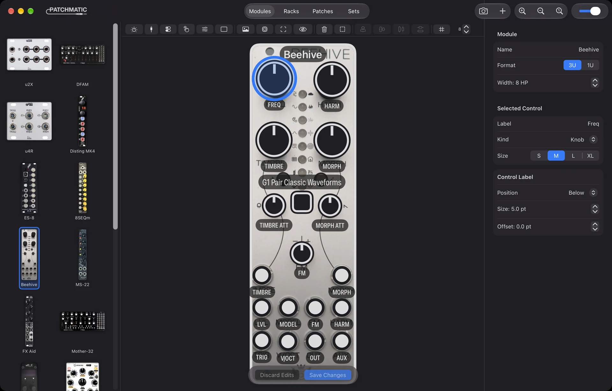
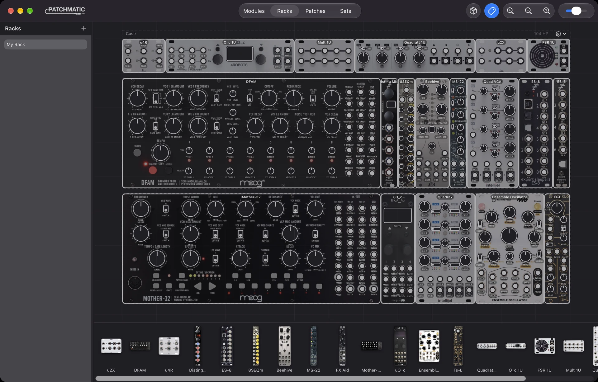
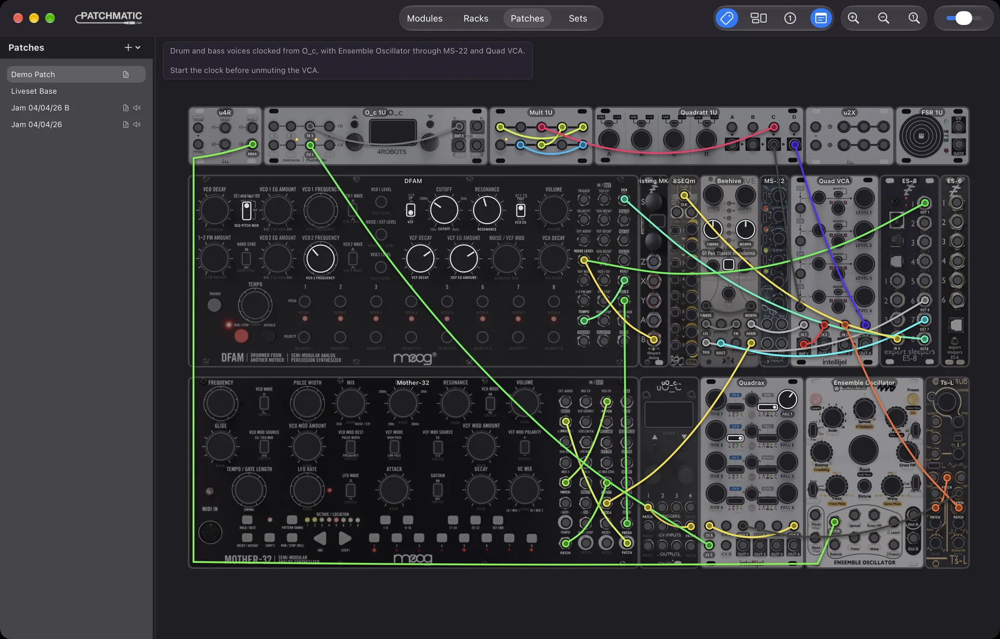
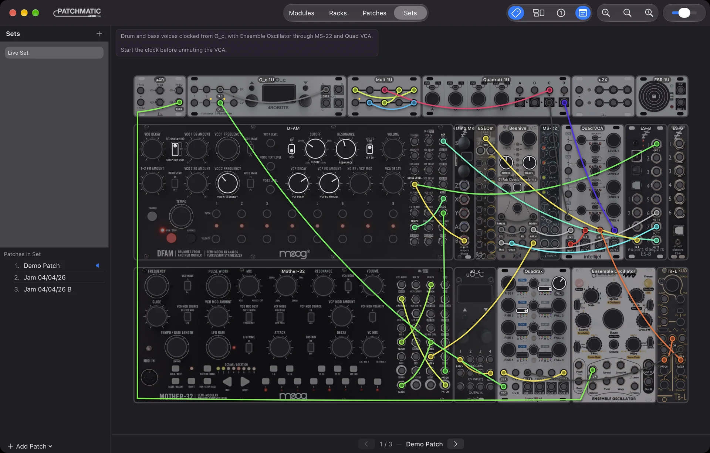

# Getting Started

Patchmatic is organized into four modes, selected from the switcher at the top of the window or with Cmd+1 to Cmd+4. The typical workflow moves through them in order.

<figure markdown="span">
  { width="320" .strip }
</figure>

## 1. Create a module

Switch to **Modules**. Click the camera button in the window toolbar to import a photo of your hardware module; Patchmatic offers to detect its controls automatically. To start from a blank panel, click **+** instead.

<figure markdown="span">
  
</figure>

See [Module Editor](guide/module-editor.md).

## 2. Build a rack

Switch to **Racks**. Create a rack, configure its case, and drag modules from the strip at the bottom of the canvas into the rows.

<figure markdown="span">
  
</figure>

See [Rack Editor](guide/rack-editor.md).

## 3. Create a patch

Switch to **Patches**. Click **+** in the patch list and choose a rack. Drag from one patch point to another to draw a cable.

Each patch stores its own cables, control positions, notes, groups, and screen images.

<figure markdown="span">
  
</figure>

See [Patch Editor](guide/patch-editor.md).

## 4. Organize into sets

Switch to **Sets** to arrange patches into an ordered list and step through them.

<figure markdown="span">
  
</figure>

See [Sets](guide/sets.md).

## Saving changes

Edits in Modules, Racks, and Patches mode start an edit session. A **Discard Edits / Save Changes** bar appears at the bottom of the canvas until you choose one. If you switch to another module, rack, patch, or mode with unsaved changes, Patchmatic asks whether to save or discard them first.

All edits support Undo and Redo (Cmd+Z / Cmd+Shift+Z).
