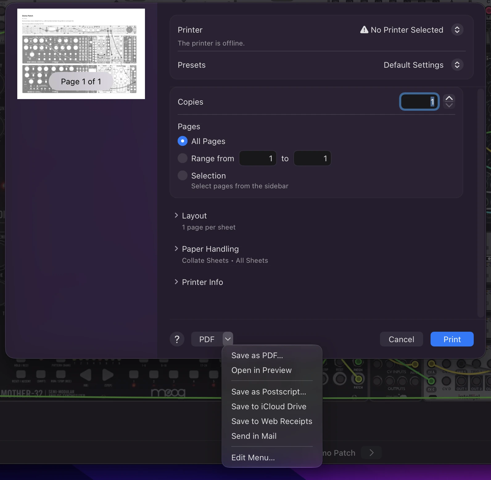
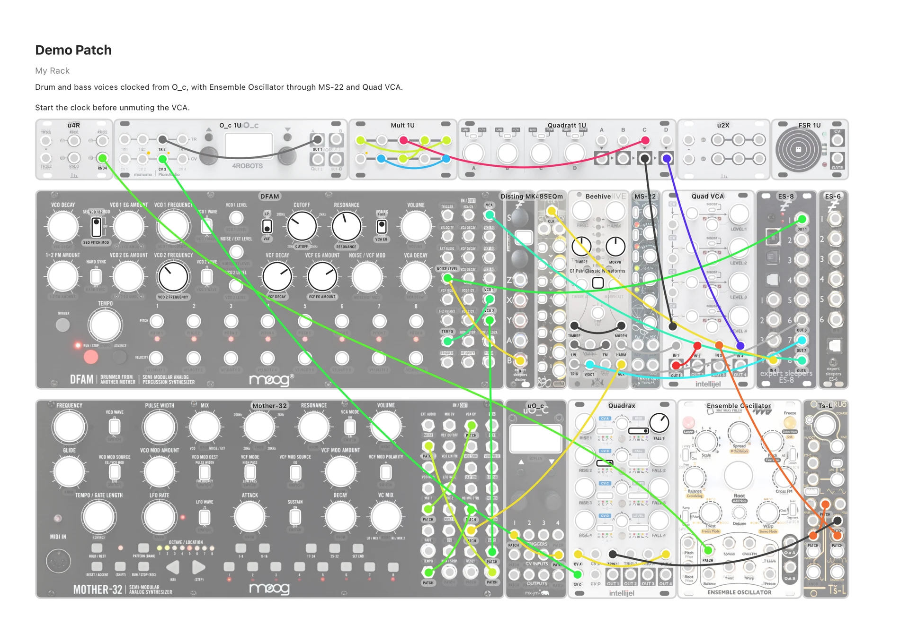

# Export

## Print to PDF

Press **Cmd+P** (or **File > Print Patch…**) in Patches or Sets mode to open the print dialog. Use the **PDF** menu in the dialog to save a PDF instead of printing.

<figure markdown="span">
  { width="560" }
</figure>

The output includes:

- The patch name and rack name as a header
- Patch notes, if any
- The full rack with every module drawn at its current control values
- All cables in the patch
- Patch point sequence numbers, if the Numbers toggle is on
- Control labels, always shown in print regardless of the Labels toggle

<figure markdown="span">
  
  <figcaption>The exported PDF, landscape because the rack is wider than it is tall.</figcaption>
</figure>

Page orientation is chosen automatically: landscape if the rack is wider than it is tall, portrait otherwise. The content is scaled to fit the page with 18 pt margins.
