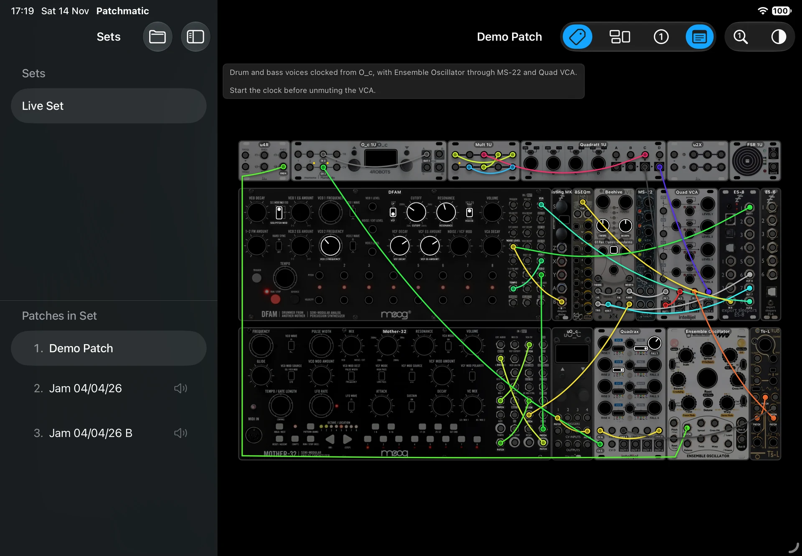
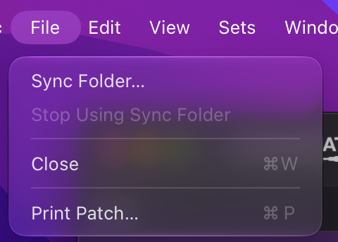
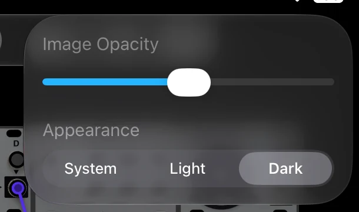
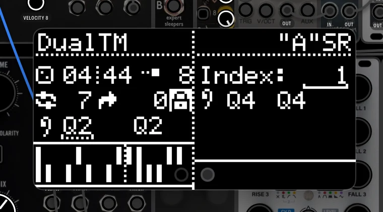

# iPad

Patchmatic for iPad lets you browse your sets on stage or at the rack. It reads the library from a sync folder in iCloud Drive that the Mac app writes to. The iPad never modifies the library; all editing happens on the Mac.

<figure markdown="span">
  
</figure>

## Setting up the sync folder on the Mac

1. Choose **File > Sync Folder…**.
2. Select a folder in iCloud Drive (the dialog opens there) and click **Use Folder**.

<figure markdown="span">
  { width="240" }
</figure>

Patchmatic moves the library into the folder, along with its screen images and audio. If the folder already contains a Patchmatic library, you are asked before it is replaced with the library on the Mac.

While a sync folder is in use, Patchmatic saves to it every 30 seconds when no edit is in progress, so changes reach the iPad without quitting the app.

To keep the library only on the Mac again, choose **File > Stop Using Sync Folder**. The library, images, and audio are copied back to the Mac's local storage.

!!! warning
    If the sync folder cannot be read at launch, Patchmatic shows a warning and uses the copy stored on the Mac. Changes made in that state do not reach the iPad. Check that iCloud Drive is available, then relaunch or choose the folder again.

## Connecting the iPad

On first launch, tap **Choose Folder** and select the same iCloud Drive folder you chose on the Mac. The library loads and the folder is remembered. To switch folders later, tap the folder button at the top of the sidebar.

If the library cannot be loaded, tap **Try Again** or **Choose Another Folder**.

The iPad reloads the library automatically when it changes on the Mac, and again when the app returns to the foreground.

## Browsing sets

The sidebar has two lists:

- **Sets** — tap a set to open it
- **Patches in Set** — tap a patch to jump to it; patches with an audio preview have a play button

The selected set and patch are remembered on the iPad.

Hide the sidebar to give the rack the full screen. With the sidebar hidden:

- Swipe in from the left edge of the screen for the previous patch, or from the right edge for the next
- Dots along the bottom show the position in the set, brightening briefly when the patch changes

<figure markdown="span">
  
</figure>

## Viewing a patch

The toolbar has the same **Labels**, **Groups**, **Numbers**, and **Notes** toggles as the Mac, plus:

- **Frame Rack** — fit the rack to the screen. The rack also refits when the iPad rotates or the sidebar is shown or hidden.
- **Display** — module image opacity and appearance (System, Light, or Dark)

<figure markdown="span">
  { width="300" }
</figure>

Pinch to zoom.

**Notes** — tap a module note or a patch point note dot to read it.

<figure markdown="span">
  { width="400" }
</figure>

**Screen images** — tap a screen to open the magnifier, and swipe to page between its images. Tap the magnified image to close it.

<figure markdown="span">
  { width="380" }
</figure>

**Patch notes** — the overlay at the top of the canvas shows the patch notes, with a play button when the patch has an audio preview.

## Requirements

- iPadOS 17.0 or later
- An iCloud Drive folder shared with a Mac running Patchmatic
