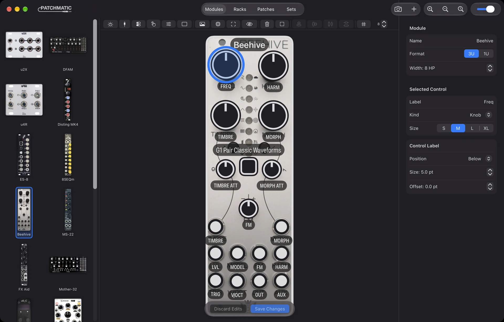
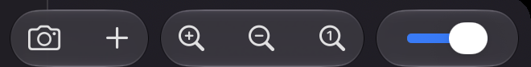
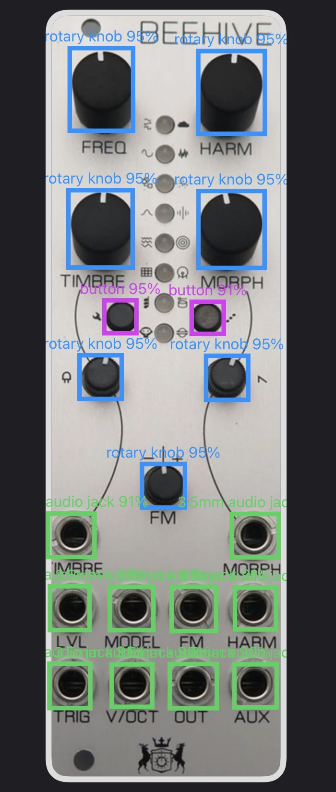
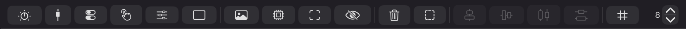
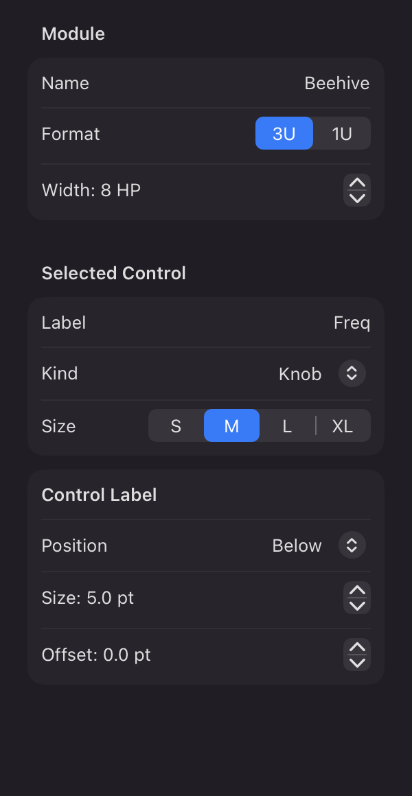
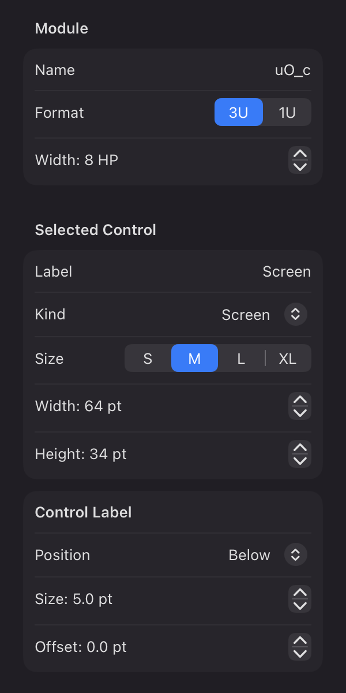
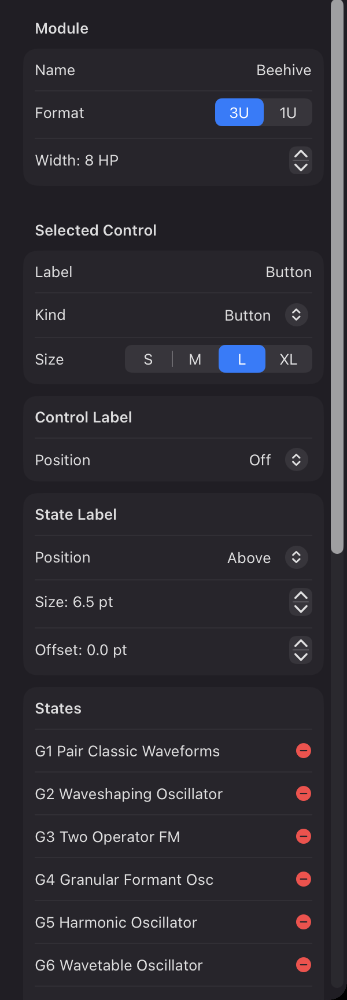
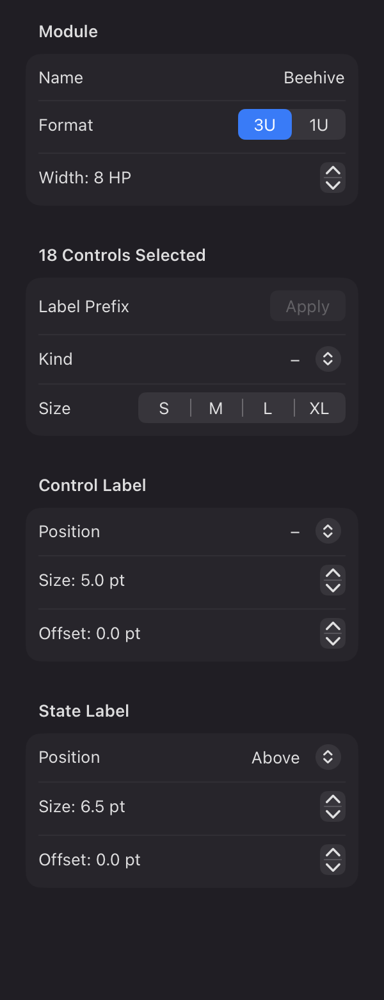

# Module Editor

The Module Editor is where you define the layout of individual Eurorack modules. Each module definition is a reusable template that can be placed into any number of racks.

<figure markdown="span">
  
  <figcaption>The module library, the panel canvas with its toolbar, and the inspector.</figcaption>
</figure>

## Creating a module from a photo

Click the camera button in the window toolbar, drag an image file onto the library, or use **Modules > New Module from Image** (Cmd+N). Supported formats are PNG, JPEG, TIFF, and HEIC.

<figure markdown="span">
  { width="330" .strip }
</figure>

Patchmatic creates a new module, sets the photo as its background image, and offers to run automatic control detection. The model identifies knobs, patch points, toggle switches, buttons, and sliders, places them on the panel, and estimates the module's format (1U or 3U) and width in HP.

Review the results after detection — some controls may be missed or misclassified. To re-run detection at any time, click **Analyse Background Image** in the canvas toolbar, or press Cmd+Shift+A.

<figure markdown="span">
  { width="300" }
  <figcaption>Show Detections draws the boxes from the last analysis, color-coded by control type with a confidence score. Hide Controls is turned on here so the photo is visible.</figcaption>
</figure>

To create a blank module instead, click **+** or press Cmd+Shift+N.

## The library

Right-click a module in the library for **Rename**, **Duplicate**, and **Delete**. The menu also has an **Add to *case name*** submenu for each case in the active rack, listing the rows that match the module's format. Deleting a module that is placed in a rack asks for confirmation first.

## Module properties

Edit the module's name, format (3U or 1U), and width in HP at the top of the inspector. Changing the format rescales the HP width proportionally.

## The canvas toolbar

<figure markdown="span">
  { .strip }
</figure>

From left to right:

| Group | Buttons |
|---|---|
| Place controls | Knob, Patch Point, Toggle Switch, Button, Slider, Screen |
| Background image | Set Background Image, Analyse Background Image, Show Detections, Hide Controls |
| Selection | Delete Selected Controls, Snap Selected to Grid |
| Alignment | Centre Horizontally, Centre Vertically, Distribute Horizontally, Distribute Vertically |
| Grid | Show Grid, Grid Divisions (2–128) |

## Adding controls manually

Select a control type in the canvas toolbar to enter placement mode, then click the canvas to place a control. Click the active button again to leave placement mode.

| Type | Description |
|---|---|
| Knob | Rotary control |
| Patch Point | 3.5 mm jack |
| Toggle Switch | Multi-position switch |
| Button | Momentary or latching button |
| Slider | Linear fader |
| Screen | Rectangular display area |

## Control properties

Select a control to edit it in the inspector. The available properties depend on the control type.

<figure markdown="span">
  { width="260" }
  <figcaption>Knob: label, kind, size, and label position.</figcaption>
</figure>

<figure markdown="span">
  { width="260" }
  <figcaption>Screen: independent width and height.</figcaption>
</figure>

<figure markdown="span">
  { width="260" }
  <figcaption>Button: a separate state label and a list of named states.</figcaption>
</figure>

- **Size** — small, medium, large, or extra large (patch points are always medium)
- **Orientation** — vertical or horizontal (toggle switches and sliders)
- **Control Label** — position (above, below, left, right, or off), font size, and offset
- **State Label** — position, size, and offset of the state name shown for buttons and toggle switches
- **States** — named states for buttons and toggle switches; minimum 2, no maximum
- **Width / Height** — screens
- **Length** — sliders

### Editing several controls at once

With two or more controls selected, the inspector switches to batch editing: a label prefix, kind, size, and label settings applied to every selected control.

<figure markdown="span">
  { width="260" }
</figure>

## Selecting and editing controls

| Action | Behaviour |
|---|---|
| Click control | Select a single control |
| Shift+Click | Add or remove from selection |
| Drag on empty space | Pan the canvas |
| Shift+Drag on empty space | Marquee selection |
| Click empty space | Clear selection |
| Click overlapping controls repeatedly | Cycle through the stack |
| Cmd+A | Select all controls |
| Cmd+D | Duplicate selected controls (offset slightly) |
| Delete | Remove selected controls |
| Arrow keys | Nudge selected controls 0.5 pt |
| Shift+Arrow keys | Nudge 5 pt |

## Resizing controls

Screens and sliders can be resized by dragging a handle on their selection highlight:

| Control | Handle location | Resizes |
|---|---|---|
| Screen | Bottom-right corner | Width and height |
| Horizontal slider | Right edge | Length |
| Vertical slider | Bottom edge | Length |

## Alignment and grid

- **Snap Selected to Grid** — moves the selected controls to the nearest grid intersection. The grid cell size is the shorter side of the panel divided by **Grid Divisions**.
- **Show Grid** — draws the grid over the panel.
- **Centre Horizontally / Vertically** — aligns the selection to its average position (2+ controls).
- **Distribute Horizontally / Vertically** — spaces controls evenly between the two outermost (3+ controls).

## Background image

The imported photo sits behind the controls. Use the **Image Opacity** slider in the window toolbar to fade it while positioning controls. To replace the photo without re-running detection, click **Set Background Image** in the canvas toolbar.

## Canvas navigation

- **Scroll wheel or pinch** — zoom (1×–8×)
- **Option+Drag or drag on empty space** — pan
- **Zoom In / Zoom Out** — toolbar buttons or Cmd+= / Cmd+-
- **Frame** — reset zoom and centre the view (Cmd+0)

## Saving

Any change starts an edit session with a **Discard Edits / Save Changes** bar at the bottom of the canvas. Saving a module that is placed in a rack asks for confirmation, then updates every placement.
