# Patch Editor

A patch is a snapshot of a rack: it stores cable connections, control positions, notes, groups, and screen images independently from every other patch on the same rack. You can have as many patches per rack as you like.

<figure markdown="span">
  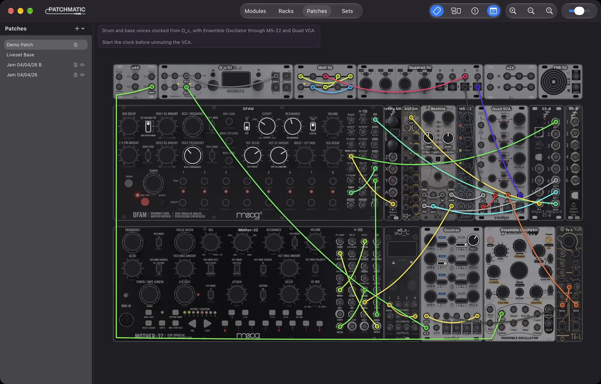
</figure>

## Toolbar

<figure markdown="span">
  { width="480" .strip }
</figure>

| Toggle | Action |
|---|---|
| Labels | Show or hide control labels |
| Groups | Show or hide group overlays and the group list |
| Numbers | Show or hide patch point sequence numbers |
| Notes | Show or hide the patch notes overlay |

The toolbar also has zoom in, zoom out, frame to fit, and the module image opacity slider.

## Creating, duplicating, and deleting patches

Click **+** in the patch list, or use **Patches > New Patch**, and choose a rack from the submenu.

Right-click a patch in the list for **Rename**, **Patch Notes…**, **Duplicate**, and **Delete…**. Duplicating (Cmd+D) copies the cables, control values, screen images, notes, groups, patch notes, and audio.

<figure markdown="span">
  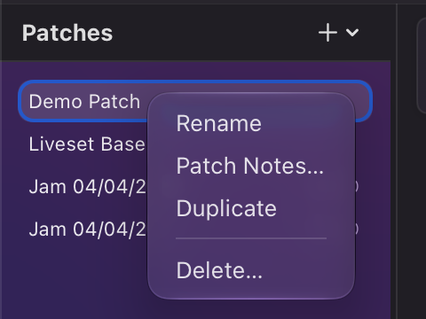{ width="240" }
</figure>

<figure markdown="span">
  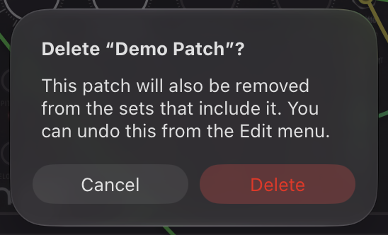{ width="290" }
</figure>

Deleting a patch asks for confirmation, and warns if the patch will also be removed from any sets. Deletion can be undone with **Edit > Undo**, which restores the patch and its place in each set.

## Drawing cables

Drag from one patch point to another. A preview cable follows the pointer, and the cable is created when you release over a valid patch point. Colors are assigned automatically from a 24-color palette in rotation.

To change a cable's color, right-click it and choose **Change Color**.

<figure markdown="span">
  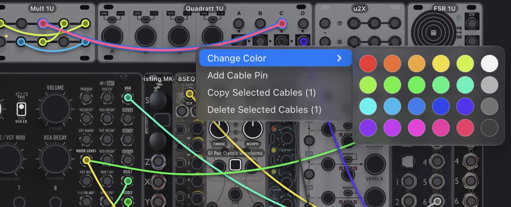
  <figcaption>Right-clicking a cable selects it and opens its menu.</figcaption>
</figure>

## Selecting cables

- Right-click a cable to select it and show its context menu
- Shift+Click a cable to add it to or remove it from the selection
- Shift+Drag to draw a marquee; every cable it touches is added to the selection (when the Groups toggle is off)
- Right-click a patched patch point to select all of its cables and show the cable menu

<figure markdown="span">
  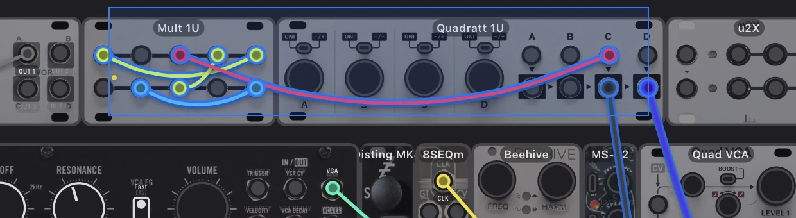
  <figcaption>Shift+Drag selects every cable the rectangle touches.</figcaption>
</figure>

## Deleting cables

Delete the selected cables with the Delete key or **Delete Selected Cables** in the cable menu.

The canvas context menu also has a **Delete Cable** submenu listing every cable by its endpoints, in the form "Module Jack → Module Jack". A patch point without a label is shown by its sequence number.

<figure markdown="span">
  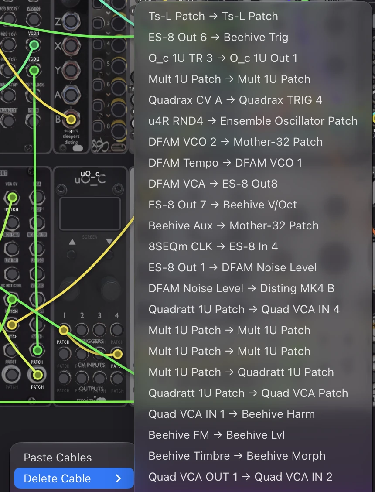{ width="430" }
</figure>

## Copying and pasting cables

Copy the selected cables with **Cmd+C**, **Copy Selected Cables** in the cable menu, or **Patches > Copy Cables**. Paste with **Cmd+V**, **Paste Cables** in the canvas or cable menu, or **Patches > Paste Cables**.

<figure markdown="span">
  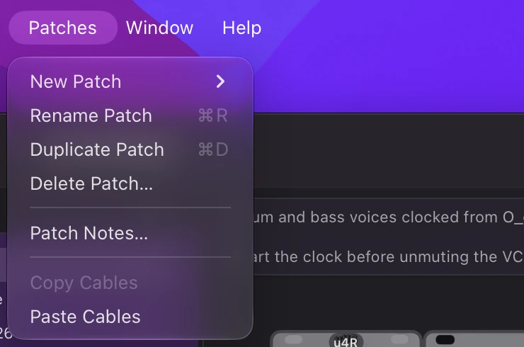{ width="370" }
</figure>

Cables can only be pasted into a patch on the rack they were copied from. Pasted cables become the selection. Cables whose modules are no longer in the rack, or that duplicate an existing connection, are skipped.

## Routing cables with pins

Pins are waypoints that redirect a cable's path.

- **Cmd+Click** a cable, or choose **Add Cable Pin** in its menu, to add a pin
- Drag a pin to move it
- Right-click a pin and choose **Delete Cable Pin**, or select it and press Delete

Pins attached to a case move with the case.

## Adjusting controls

- **Knobs** — drag vertically (up increases, down decreases)
- **Sliders** — drag along the slider
- **Toggle switches and buttons** — click to step to the next named state

All control values are stored per patch.

## Screen images

Hover over a screen to show its toolbar:

<figure markdown="span">
  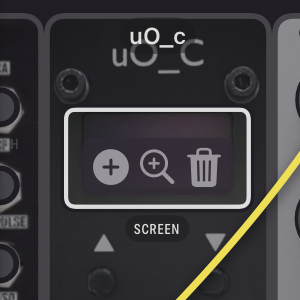{ width="150" }
</figure>

- **+** — attach an image
- **Magnifier** — show the current image enlarged
- **Trash** — delete the current image
- **← / →** — cycle through images, when a screen has more than one

Attaching an image opens a dialog. By default the whole image is used. Check **Crop Image** to show a crop rectangle, and **Lock Aspect Ratio** to keep it to the screen's shape.

<figure markdown="span">
  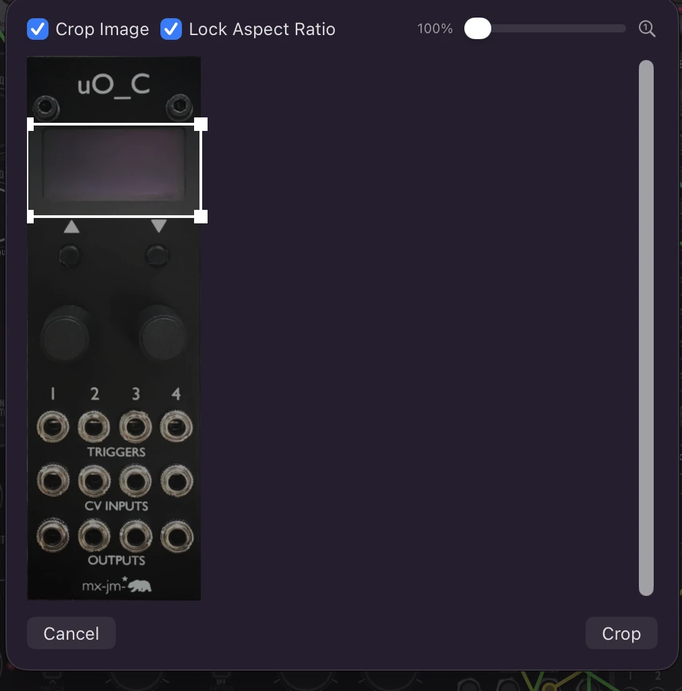{ width="500" }
  <figcaption>Cropping a module photo to just its display.</figcaption>
</figure>

## Notes

**Patch point notes** — right-click a patch point with no cables and choose **Add Patch Point Note** or **Edit Patch Point Note**. A dot marks the patch point; hover over it to read the note.

<figure markdown="span">
  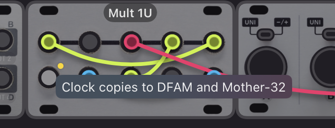{ width="340" }
</figure>

**Module notes** — right-click the module body (not over a patch point) and choose **Add Note** to place a free-form note on the panel.

Both kinds of note are stored per patch.

## Groups

Groups color-highlight sets of modules. Turn on the **Groups** toggle to show the overlays and the floating group list.

<figure markdown="span">
  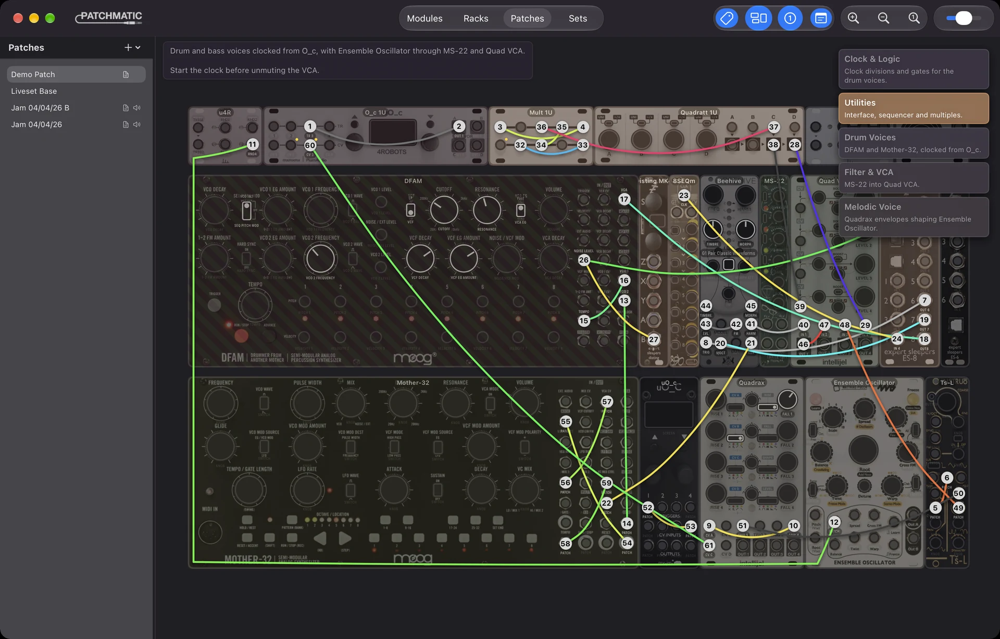
  <figcaption>Groups and Numbers turned on. Hovering a group card highlights its modules.</figcaption>
</figure>

With the Groups toggle on:

- **Create a group** — right-click a module and choose **New Group with *name***. Shift+Right-click to add more modules to the selection first.
- **Add or remove modules** — right-click a module and use **Add to Group** or **Remove from Group**
- **Hover a group card** — highlights that group's modules and fades the rest
- **Click a group card** — frames the group's modules
- **Right-click a group card** — rename, edit notes, or delete the group

## Patch notes

Each patch has free-form notes and an optional audio preview. The notes appear in an overlay at the top of the canvas when the **Notes** toggle is on, Hover over the overlay to show a play button when audio is attached.

<figure markdown="span">
  { width="600" }
</figure>

Click the overlay, choose **Patch Notes…** from the canvas or patch list menu, or use **Patches > Patch Notes…** to edit them. **Attach Audio Preview** adds an audio file to the patch.

<figure markdown="span">
  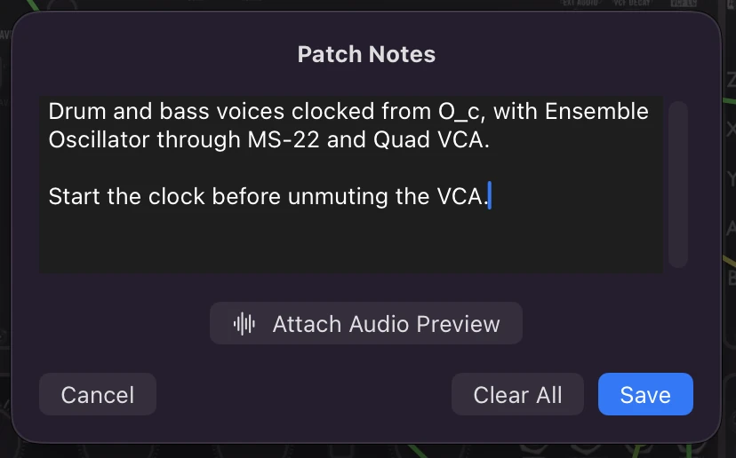{ width="410" }
</figure>

## Canvas navigation

- **Scroll wheel or pinch** — zoom (0.25×–5.0×)
- **Drag on empty space** — pan
- **Frame to Fit** — fits all cases to the viewport (Cmd+0 or toolbar button)

## Saving

Changes start an edit session with a **Discard Edits / Save Changes** bar at the bottom of the canvas.
