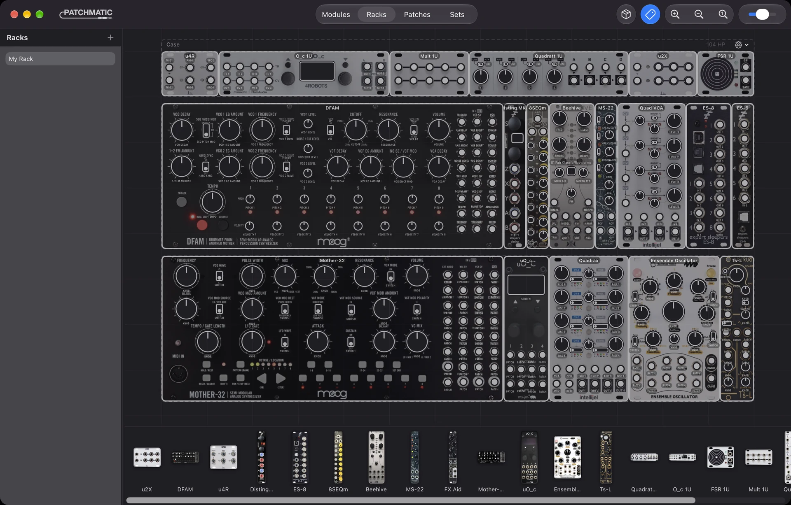
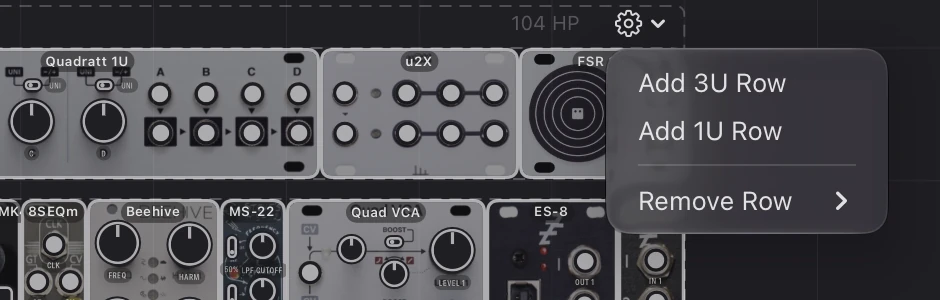
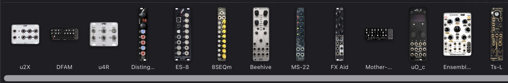
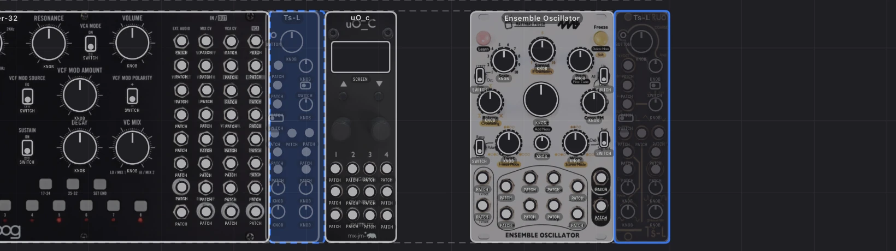

# Rack Editor

The Rack Editor is where you assemble module definitions into a physical case layout.

<figure markdown="span">
  
  <figcaption>A case with one 1U row and two 3U rows. Modules are dragged in from the strip at the bottom.</figcaption>
</figure>

## Racks and cases

A **rack** is a top-level container that holds one or more **cases**. Cases represent physical enclosures; several cases in one rack model a multi-case setup as a single unit.

To create a rack, click **+** in the rack list (or Cmd+N). To add a case, click **New Case** in the toolbar, press Cmd+Shift+C, or right-click empty canvas space. New cases start with two rows.

<figure markdown="span">
  { width="340" .strip }
  <figcaption>New Case, Labels, zoom and frame, and module image opacity.</figcaption>
</figure>

## Configuring a case

- **Rename** — click the case name in its header
- **HP width** — click the HP value in the header; it applies to every row in the case
- **Add a row** — click the gear in the header (or right-click the case) and choose **Add 3U Row** or **Add 1U Row**
- **Remove a row** — the same menu, **Remove Row**; this also removes the modules in that row

<figure markdown="span">
  { width="470" }
</figure>

## Placing modules

Drag a module thumbnail from the **module strip** onto a row. A dashed outline shows the target position while dragging.

<figure markdown="span">
  
</figure>

Placement rules:

- A 3U module can only go in a 3U row, and a 1U module in a 1U row
- The row must have enough free HP at the drop position

You can also right-click a module in the [Module Editor](module-editor.md#the-library) library and use **Add to *case name***.

To remove a module, select it and press Delete, or right-click it and choose **Delete**.

## Moving modules

Drag a placed module to move it. Modules snap to the HP grid and can be dragged to another row or another case.

If you drag a single module onto modules already in a row, they are pushed aside to make room: modules whose centre is left of the dragged module move left, the rest move right. The new positions are previewed while you drag. The move is only allowed if the row has enough free HP in total.

<figure markdown="span">
  
  <figcaption>Dragging Ts-L into uO_c's position pushes uO_c to the right.</figcaption>
</figure>

Select several modules with Shift+Click or a marquee drag, then drag one of them to move them all. A multi-module move stays within its case.

Use the Left and Right arrow keys to nudge selected modules by 1 HP.

## Arranging cases on the canvas

Drag a case by its header to reposition it on the canvas. Guide lines appear when a case aligns with another, and cases snap to an 8 HP grid while dragging. Selecting several cases and dragging one moves them together.

## Canvas navigation

- **Scroll wheel or pinch** — zoom (0.25×–5.0×)
- **Drag on empty space** — pan
- **Frame to Fit** — fits all cases to the viewport (Cmd+0 or toolbar button)

Zoom and pan position are saved between sessions.

## Saving

Any change starts an edit session with a **Discard Edits / Save Changes** bar at the bottom of the canvas. If the rack has patches, saving asks for confirmation first.
