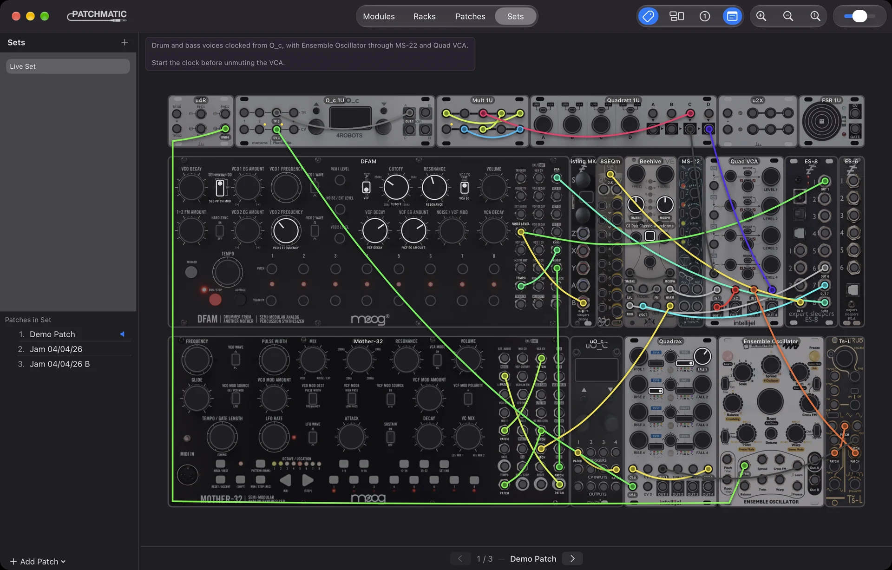
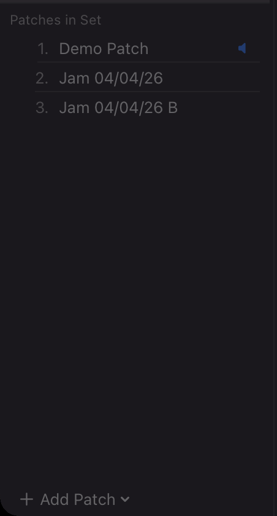

# Sets

A set is an ordered list of patches — a live performance running order, or a sequence of related configurations to step through.

<figure markdown="span">
  
</figure>

## Creating a set

In **Sets** mode, click **+** in the set list (or Cmd+N). Right-click a set to rename or delete it.

## Adding and ordering patches

The patches in the selected set are listed below the set list. Click **Add Patch** at the bottom of the sidebar and pick a patch; the menu lists the patches that are not already in the set. A patch can belong to any number of sets.

<figure markdown="span">
  { width="226" }
  <figcaption>A speaker icon marks the patch currently shown.</figcaption>
</figure>

Drag a patch row to reorder it. To remove a patch from the set, right-click it and choose **Remove from Set** — the patch itself is not deleted.

## Stepping through a set

Use the **Left / Right arrow keys** (or Cmd+← / Cmd+→), or the buttons in the bar at the bottom of the canvas. The bar shows the position and the current patch name. Clicking a patch in the list jumps straight to it.

<figure markdown="span">
  { width="500" .strip }
</figure>

## Read-only canvas

The canvas in Sets mode is read-only: cables cannot be created or deleted, controls cannot be adjusted, and no context menus appear. The patch notes overlay can still be clicked to read the notes for the current patch.

To change a patch, edit it in **Patches** mode and return to Sets.

Sets can also be browsed on an iPad — see [iPad](ipad.md).
