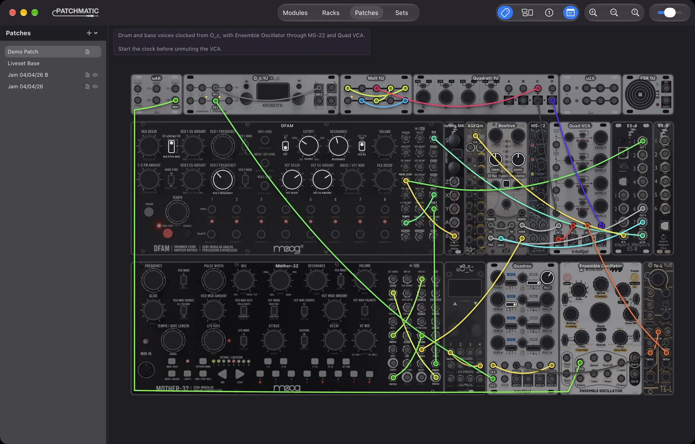

# Patchmatic

Patchmatic is a macOS application for recording your Eurorack patches — a mix of Modulargrid and VCV Rack without the audio. The name comes from "Patch Schematic"; the original idea was a tool for creating easy-to-read schematics to enable efficient repatching.

<figure markdown="span">
  
</figure>

## Features

**Module design**

- Place knobs, patch points, buttons, toggle switches, sliders, and screens on a panel
- Adjustable control size, orientation, and label positioning
- Import a panel photo — controls are detected automatically

**Rack assembly**

- Arrange modules in cases with 1U and 3U rows at any HP width
- Stack multiple cases on a free-form canvas

**Patching**

- Draw cables between any two patch points, across cases
- Physics-based cable rendering with color selection
- Route cables with intermediate pin points
- Copy and paste cables between patches on the same rack
- Add notes to patch points, modules, and patches
- Group modules with color-coded labels
- Multiple patches per rack

**Sets**

- Organize patches into named, ordered sets for live performance or workflow

**Export**

- Print or export patches to PDF

**iPad**

- Browse sets on iPad, synced from the Mac through an iCloud Drive folder

## Requirements

- macOS 14.0 (Sonoma) or later
- Apple Silicon or Intel
- iPad app: iPadOS 17.0 or later

## Installation

1. Download `Patchmatic-<version>.dmg` from the [Releases](https://github.com/pkyme/patchmatic/releases) page.
2. Open the DMG and drag Patchmatic to Applications.
3. First launch: right-click the app and select **Open** (the app is not notarized).

Then follow [Getting Started](getting-started.md).
